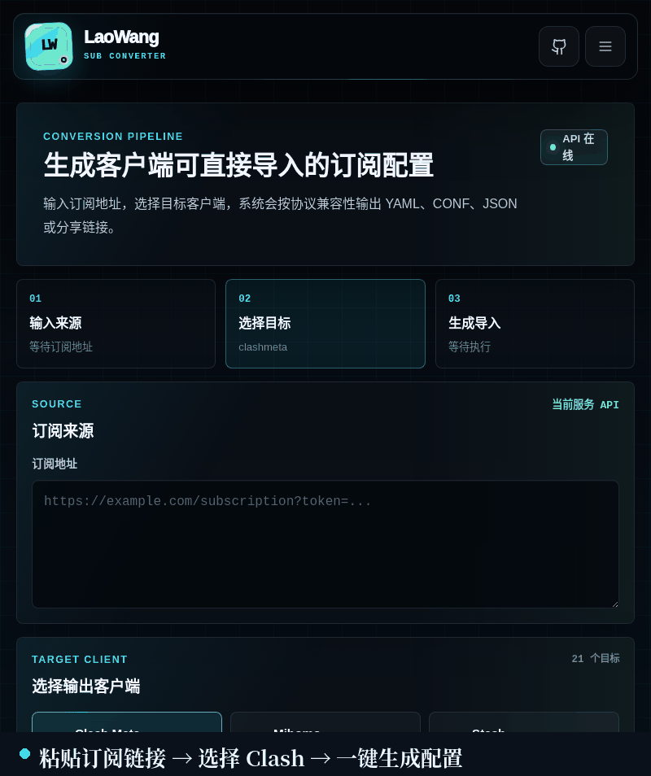

# LaoWang Sub Converter

一个面向自托管场景的代理订阅转换、合并、检测与分发平台。项目提供 Vue 控制台、Node.js API、持久化短链接以及适用于 `linux/amd64`、`linux/arm64` 的生产 Docker 镜像。

## 演示

> 演示使用本地示例订阅（`demo.example.com` 假节点），约 10 秒看完核心流程：粘贴订阅链接，选择 Clash，一键生成可导入的订阅配置。

## 项目截图

### 总览

查看更多界面

### 订阅转换

### 订阅合并

### 短链接管理

## 核心功能

- **订阅转换**：输入订阅地址，生成 YAML、JSON、CONF 或分享链接。
- **订阅合并**：批量拉取最多 20 个订阅，支持精确去重、排序、关键词过滤、重命名和地区标识。
- **客户端兼容过滤**：按目标客户端实际支持范围输出节点；没有兼容节点时返回明确错误，不生成空配置。
- **节点检测**：从部署服务器检测节点 TCP 连通性与延迟，并导出在线节点。
- **短链接管理**：为长订阅地址生成固定短码，支持访问次数统计、列表管理和删除。
- **二维码导入**：转换结果可生成订阅二维码；分享链接格式可按节点生成二维码。
- **规则模板**：为 YAML 客户端提供基础、标准、开发、游戏和流媒体规则模板。
- **生产部署**：提供非 root 容器、只读文件系统、健康检查、持久化数据目录和多架构镜像。

## 协议与客户端

### 输入协议

| 类型 | 支持 |
| --- | --- |
| Shadowsocks | SS、simple-obfs 插件 |
| ShadowsocksR | SSR |
| V2Ray/Xray | VMess、VLESS、VLESS Reality、Trojan |
| QUIC/新协议 | Hysteria、Hysteria2、TUIC、AnyTLS |
| 其他代理 | Snell、HTTP、SOCKS5 |
| 结构化配置 | Clash/Mihomo YAML、sing-box JSON |

### 输出目标

| 配置体系 | 客户端 |
| --- | --- |
| YAML | Clash、Clash Meta、Mihomo、Stash、Clash Verge、Clash Nyanpasu、FlClash |
