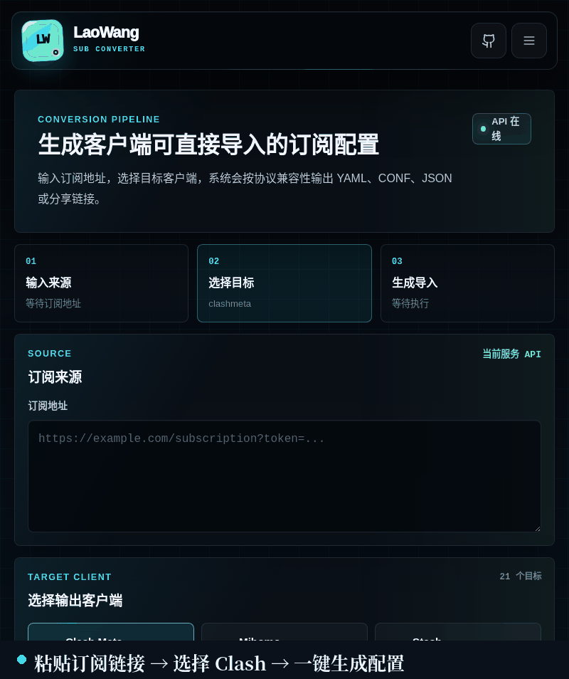

# LaoWang Sub Converter

A self-hosted subscription conversion, merging, health-check and distribution platform for proxy clients. It ships a Vue console, a Node.js API, persistent short links and production Docker images for `linux/amd64` and `linux/arm64`.

[](https://github.com/tony-wang1990/laowang-sub-converter/actions/workflows/docker-publish.yml)
[](https://github.com/tony-wang1990/laowang-sub-converter/pkgs/container/laowang-sub-converter)
[](package.json)
[](LICENSE)

## Demo



> Recorded with a local sample subscription (fake `demo.example.com` nodes). The core flow in about 10 seconds: paste a subscription URL, pick Clash, and generate an importable config.

[中文文档](README.md)

## Screenshots

### Overview


<details>
<summary>More screenshots</summary>

### Subscription conversion


### Subscription merging


### Short link management


</details>

## Features

- **Subscription conversion**: paste a subscription URL and get YAML, JSON, CONF or share links.
- **Subscription merging**: pull up to 20 subscriptions in one batch, with exact dedupe, sorting, keyword filtering, renaming and region flags.
- **Client compatibility filtering**: nodes are emitted only in the formats the target client actually supports; if no node is compatible, the API returns a clear error instead of an empty config.
- **Node health check**: test TCP reachability and latency from the server and export the online nodes.
- **Short links**: turn long subscription URLs into fixed short codes, with click counts, listing and deletion.
- **QR code import**: conversion results can be rendered as a subscription QR code; supported share-link formats can also generate QR codes.
- **Rule presets**: basic, standard, developer, gaming and streaming rule templates for YAML clients.
- **Production deployment**: non-root container, read-only filesystem, health check, persistent data directory and multi-arch images.

## Protocols and Clients

### Input protocols

| Type | Supported |
| --- | --- |
| Shadowsocks | SS, simple-obfs plugin |
| ShadowsocksR | SSR |
| V2Ray / Xray | VMess, VLESS, VLESS Reality, Trojan |
| QUIC / newer protocols | Hysteria, Hysteria2, TUIC, AnyTLS |
| Other proxies | Snell, HTTP, SOCKS5 |
| Structured configs | Clash / Mihomo YAML, sing-box JSON |

### Output targets

| Config family | Clients |
| --- | --- |
| YAML | Clash, Clash Meta, Mihomo, Stash, Clash Verge, Clash Nyanpasu, FlClash |
| sing-box JSON | sing-box, Hiddify, NekoBox, SFA, SFI, SFM |
| CONF / text | Surge, Surfboard, Loon, Quantumult X |
| Share links / Base64 | Shadowrocket, V2RayN, V2RayNG, V2RayU |

Different clients do not support the same protocols. The project keeps a unified compatibility matrix and uses per-client field formats for Mihomo, Stash, Surge, Surfboard, Quantumult X, Loon and sing-box.

## Quick Deploy

### No Vercel one-click deploy

This project **does not support Vercel one-click deploy** and ships no `vercel.json` or Deploy button. It is a long-running Node.js service: conversion, merging, node checks and short-link persistence all need a backend and a writable data directory, which static / serverless hosting cannot provide. An older repository description claiming "Vercel one-click deploy" is wrong — please follow this document instead, and remove that claim from the repository description on the GitHub website (it lives outside the code; see [CHANGELOG](CHANGELOG.md)). Use Docker or the one-click script below.

### System requirements

- Linux server: Ubuntu, Debian, Rocky Linux, AlmaLinux, CentOS, etc.
- `amd64` or `arm64`
- One public TCP port, default `3000`
- root or `sudo`

### One-click install

```bash
curl -fsSL "https://raw.githubusercontent.com/tony-wang1990/laowang-sub-converter/main/scripts/deploy.sh?$(date +%s)" | sudo bash
```

The script installs or reuses Docker, pulls the production image, creates the persistent data directory and waits for the health check.

Defaults:

| Item | Value |
| --- | --- |
| Image | `ghcr.io/tony-wang1990/laowang-sub-converter:latest` |
| Install dir | `/opt/laowang-sub-converter` |
| Data dir | `/opt/laowang-sub-converter/data` |
| Host port | `3000` |
| Container user | `10001:10001` |

Then open:

```text
http://SERVER_PUBLIC_IP:3000
```

Health check:

```bash
curl http://127.0.0.1:3000/healthz
```

Expected response:

```json
{"status":"ok","timestamp":"2026-01-01T00:00:00.000Z"}
```

### Update

```bash
curl -fsSL "https://raw.githubusercontent.com/tony-wang1990/laowang-sub-converter/main/scripts/deploy.sh?$(date +%s)" |
  sudo bash -s update
```

Or update manually in the install directory:

```bash
cd /opt/laowang-sub-converter
docker compose pull
docker compose up -d --force-recreate
docker compose ps
curl http://127.0.0.1:3000/healthz
```

### Docker Compose

```yaml
services:
  laowang-sub-converter:
    image: ghcr.io/tony-wang1990/laowang-sub-converter:latest
    container_name: laowang-sub-converter
    environment:
      NODE_ENV: production
      PORT: 3000
      DATA_DIR: /app/data
      ALLOW_PRIVATE_SUBSCRIPTION_URLS: "0"
      PUBLIC_BASE_URL: ""
    ports:
      - "3000:3000"
    volumes:
      - ./data:/app/data
    restart: unless-stopped
    read_only: true
    tmpfs:
      - /tmp
    security_opt:
      - no-new-privileges:true
```

```bash
mkdir -p data
sudo chown -R 10001:10001 data
sudo chmod 750 data

docker compose pull
docker compose up -d
docker compose ps
```

Using the repository's own `docker-compose.yml` stores data in the Docker named volume `laowang-data`.

## HTTPS and Reverse Proxy

Put Nginx Proxy Manager, Caddy or Nginx in front of the service for a domain name and HTTPS. When using a domain, set `PUBLIC_BASE_URL` so generated short links use the correct HTTPS address:

```bash
curl -fsSL "https://raw.githubusercontent.com/tony-wang1990/laowang-sub-converter/main/scripts/deploy.sh?$(date +%s)" |
  sudo env PUBLIC_BASE_URL=https://sub.example.com bash
```

## Environment Variables

| Variable | Default | Description |
| --- | --- | --- |
| `PORT` | `3000` | Port the service listens on inside the container |
| `DATA_DIR` | `/app/data` | Short link data directory |
| `PUBLIC_BASE_URL` | empty | Public base URL used when generating short links |
| `TRUST_PROXY` | `1` | Number of trusted reverse-proxy hops (Express setting) |
| `ALLOW_PRIVATE_SUBSCRIPTION_URLS` | `0` | Whether the backend may fetch localhost, private IPs and `.local` domains |
| `ADMIN_TOKEN` | empty (unset) | Short link admin token. When set, creating / listing / deleting short links requires the token (the `X-Admin-Token` header or the `?token=` query parameter); when unset, management stays unauthenticated and the startup log prints a warning — see [Security](#security) |
| `RATE_LIMIT_WINDOW_MS` | `60000` | Global rate-limit window in milliseconds |
| `RATE_LIMIT_MAX` | `300` | Requests allowed per IP per window; `0` disables the limiter (not recommended for public deployments) |

Private addresses are blocked by default to reduce SSRF risk on public deployments. Enable `ALLOW_PRIVATE_SUBSCRIPTION_URLS=1` only for trusted intranet / personal deployments that really need to fetch intranet subscriptions.

## Data and Backup

Short links are stored in:

```text
/app/data/shortlinks.json
```

With the one-click script, the host path is:

```text
/opt/laowang-sub-converter/data/shortlinks.json
```

Back up with:

```bash
sudo cp -a /opt/laowang-sub-converter/data \
  "/opt/laowang-sub-converter/data-backup-$(date +%Y%m%d-%H%M%S)"
```

The data directory must belong to `10001:10001`, not `root:root`. If short link storage errors appear:

```bash
sudo chown -R 10001:10001 /opt/laowang-sub-converter/data
sudo chmod 750 /opt/laowang-sub-converter/data
```

## API

### Subscription conversion

```http
GET /api/convert?target=clashmeta&url=https%3A%2F%2Fexample.com%2Fsub
```

Common parameters:

| Parameter | Description |
| --- | --- |
| `target` | Target client, e.g. `clashmeta`, `mihomo`, `singbox`, `surge`, `v2rayn` |
| `url` | URL-encoded subscription address |
| `emoji` | Add region flags, `1` or `0` |
| `udp` | Enable UDP, `1` or `0` |
| `scert` | Skip certificate verification, `1` or `0` |
| `sort` | Sort by node name, `1` or `0` |
| `include` | Keep only nodes matching keywords, separated by `\|` |
| `exclude` | Exclude nodes matching keywords, separated by `\|` |
| `rename` | Rename rule, e.g. `old name->new name` |
| `rulePreset` | `basic`, `standard`, `developer`, `gaming`, `streaming` |

### Subscription merging

```http
POST /api/merge
Content-Type: application/json

{
  "urls": [
    "https://example.com/sub1",
    "https://example.com/sub2"
  ],
  "target": "clashmeta",
  "dedupe": true,
  "emoji": true,
  "sort": false,
  "rulePreset": "standard"
}
```

Preview nodes:

```http
POST /api/merge/preview
```

### Node health check

```http
POST /api/health/check
Content-Type: application/json

{
  "url": "https://example.com/sub",
  "timeout": 5000,
  "concurrent": 10,
  "exportTarget": "v2rayn"
}
```

You can also submit raw node content:

```json
{
  "content": "ss://...\nvmess://...",
  "exportTarget": "clashmeta"
}
```

A single check tests at most 100 nodes; `timeout` is clamped to 250–10000 ms and `concurrent` to 1–10.

### Short links

```http
POST /api/shortlink
Content-Type: application/json

{
  "url": "https://example.com/api/convert?target=clashmeta&url=...",
  "code": "my-profile"
}
```

Other endpoints:

```http
GET    /api/shortlink/list
GET    /api/shortlink/:code/stats
DELETE /api/shortlink/:code
GET    /api/targets
GET    /api/rules/presets
GET    /healthz
```

When `ADMIN_TOKEN` is set, creating, listing and deleting short links require the token — either the header:

```http
X-Admin-Token: <your ADMIN_TOKEN>
```

or the query parameter:

```http
POST /api/shortlink?token=<your ADMIN_TOKEN>
```

Following a short link (`GET /s/:code`) never requires a token, and single-link stats (`GET /api/shortlink/:code/stats`) are public too. The web console's short link page has an admin-token field; the token is kept only in the browser's sessionStorage (cleared when the tab closes) and sent as the `X-Admin-Token` header. Prefer the header over the query parameter: a token in a URL ends up in browser history and server logs.

## Local Development

Requires Node.js `>=20.19.0`.

```bash
npm ci
```

Development needs the backend and Vite running separately:

```bash
# Terminal 1
npm run server

# Terminal 2
npm run dev
```

Production mode:

```bash
npm run build
NODE_ENV=production npm run server
```

Windows PowerShell:

```powershell
npm run build
$env:NODE_ENV = "production"
npm run server
```

## Tests and Quality Gates

```bash
npm test
npm run build
npm run audit
```

Automated tests cover:

- The protocol compatibility matrix for 21 target clients
- Parsing and output for SS, SSR, VMess, VLESS / Reality, Trojan, Hysteria, TUIC, AnyTLS and more
- Conversion, merging, node health check and short link APIs
- Short link persistence, HTTPS reverse-proxy addresses and click counts
- SSRF protection for private addresses and IPv4-mapped IPv6
- Docker runtime files, data permissions and security configuration
- Frontend error messages and the production build

Pushes to `main` run tests, build and audit in GitHub Actions and publish:

```text
ghcr.io/tony-wang1990/laowang-sub-converter:latest
ghcr.io/tony-wang1990/laowang-sub-converter:main
ghcr.io/tony-wang1990/laowang-sub-converter:sha-xxxxxxx
```

## FAQ

### The browser says the connection was refused

```bash
docker compose ps
ss -lntp | grep :3000
curl http://127.0.0.1:3000/healthz
```

Check that the Compose `PORTS` column shows `0.0.0.0:3000->3000/tcp`, and check the cloud security group and system firewall.

### The container keeps restarting

```bash
docker logs --tail=200 laowang-sub-converter
docker inspect laowang-sub-converter \
  --format 'Exit={{.State.ExitCode}} Error={{.State.Error}} Restart={{.RestartCount}}'
```

Then pull the latest image:

```bash
cd /opt/laowang-sub-converter
docker compose pull
docker compose up -d --force-recreate
```

### The page is blank or the menu does not respond

Update to the latest image and hard-refresh the browser (`Ctrl + F5`). The current production build ships all pages in a single compressed JS bundle, so switching pages downloads no extra route chunks.

### Short link list fails

```bash
sudo chown -R 10001:10001 /opt/laowang-sub-converter/data
sudo chmod 750 /opt/laowang-sub-converter/data
docker restart laowang-sub-converter
```

### Short link create / list / delete returns 401

`ADMIN_TOKEN` is set on the server but the request carries no token or a wrong one. Enter the correct token in the admin-token field on the short link page of the web console, or add the `X-Admin-Token: <token>` header (or `?token=<token>`) to API calls. If you changed the token, recreate the container.

### Requests return 429 Too Many Requests

The global rate limiter fired (default: 300 requests per IP per minute). Wait the number of seconds in the `Retry-After` response header and retry; for a personal deployment you can raise `RATE_LIMIT_MAX` / `RATE_LIMIT_WINDOW_MS` and recreate the container.

## Security

- The backend refuses localhost, private IPs, link-local and reserved addresses by default.
- Every subscription redirect is re-checked.
- Subscription responses have timeout and size limits.
- Node checks are bounded: at most 100 nodes per request, `timeout` clamped to 250–10000 ms, `concurrent` clamped to 1–10.
- Global rate limiting: 300 requests per IP per minute by default; over the limit the server answers `429` with a `Retry-After` header. Counts live only in memory and reset on restart; tune with `RATE_LIMIT_WINDOW_MS` / `RATE_LIMIT_MAX`.
- Optional short link admin auth: set `ADMIN_TOKEN` and creating, listing and deleting short links require the token (the `X-Admin-Token` header or the `?token=` query parameter; comparison is constant-time for equal lengths). **Without `ADMIN_TOKEN`, short link management is unauthenticated** — anyone who can reach the service can create, list and delete short links — and the startup log prints a warning. Only leave it unset on a trusted intranet or personal deployment; for any public deployment, set a long random token (e.g. `openssl rand -hex 32`) and prefer the header over the URL parameter.
- The container runs as a non-root user with a read-only root filesystem and `no-new-privileges`.
- This is a subscription processing tool; it does not verify whether a node's source is legal or trustworthy. Do not process sensitive subscriptions from unknown sources.

To report a security issue, follow [SECURITY.md](SECURITY.md) — report privately, do not open a public issue.

## Contributing

See [CONTRIBUTING.md](CONTRIBUTING.md). Changes are tracked in [CHANGELOG.md](CHANGELOG.md).

## License

[MIT](LICENSE)
